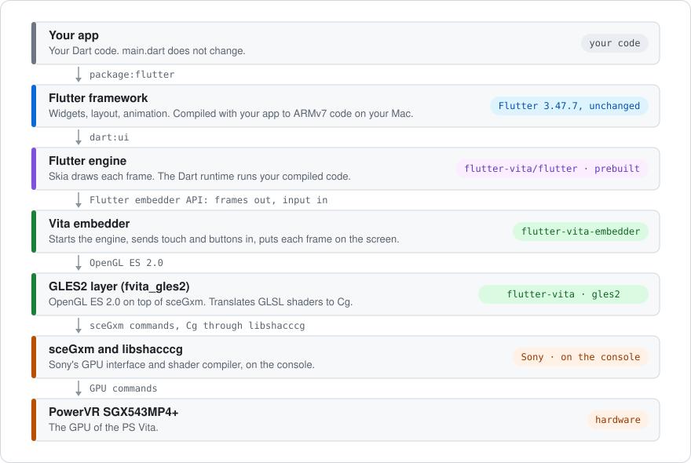
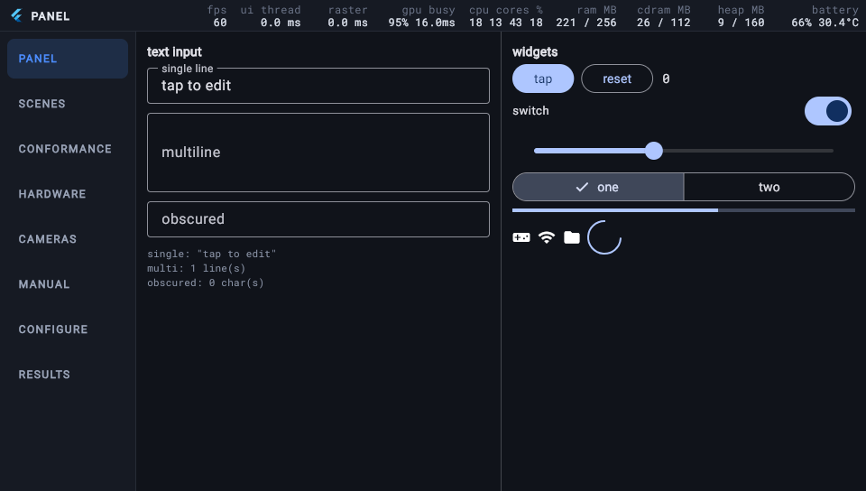

# Flutter for the PlayStation Vita

An unofficial port of Flutter to the PS Vita. It adds the PS Vita to Flutter
as a new platform. Flutter draws each frame with Skia on the console's GPU.

*PlayStation and PS Vita are trademarks of Sony Interactive Entertainment.
This project is not affiliated with or endorsed by Sony.*

## Supported devices

- **PS Vita 1000 and PS Vita 2000**: firmware 3.60 to 3.74, with HENkaku or
  h-encore².
- **Sony's shader compiler** on the card, `ur0:data/libshacccg.suprx`.
  [Console setup](docs/configure-console.md) says how to check for it.
- **The Vita3K emulator**: not supported ([why](docs/vita3k-as-a-target.md)).

## Installation

You need VitaSDK, CMake, and Python 3. You do not install Flutter. The first
`flutter-vita` command downloads Flutter 3.47.7 for the tool's own use, one
time (2.1 GB), and does not touch the Flutter you use for other projects
([details](docs/install-macos.md#2-flutter-3477)). The version is pinned,
because the prebuilt engine is built for it
([docs/versions.md](docs/versions.md)).

### macOS

On a Mac with Apple silicon, install the tool with Homebrew. The cask also
installs CMake and Python 3. Homebrew does not have VitaSDK, so you install
it yourself ([step 1](docs/install-macos.md#1-vitasdk)).

```sh
brew install --cask flutter-vita/tap/flutter-vita
```

To change the tool, clone the repository, as on Linux. All steps:
[Install on macOS](docs/install-macos.md).

### Linux

Clone the repository:

```sh
git clone --recurse-submodules https://github.com/flutter-vita/flutter-vita
cd flutter-vita
export PATH="$PWD/cli:$PATH"
```

You build the engine one time, because the prebuilt engine has
`gen_snapshot` for macOS only. All steps:
[Install on Linux](docs/install-linux.md).

### Windows

Windows is not supported yet.

## Console setup

You do these steps one time. [Console setup](docs/configure-console.md)
tells more about each step.

1. Make the console ready for homebrew: HENkaku, Enso or h-encore², and
   VitaShell.
2. Install the shader compiler plugin, `libshacccg.suprx`. Each app draws
   through the GPU, and the GPU needs this Sony plugin to compile its
   shaders. The firmware does not have it, and this repository cannot
   include it. Without it, an app starts but shows nothing. To get it:
   - Install the PlayStation Mobile Runtime with its 2.01 update.
   - Install [ShaRKF00D](https://github.com/Rinnegatamante/ShaRKF00D) with
     VitaShell, and start it. It shows no screen, and it closes when it is
     done.
   - In VitaShell, make sure that `ur0:data/libshacccg.suprx` is there.

   The plugin is a user module. It is not a kernel plugin, and you do not
   change the taiHEN configuration.
3. Connect the console to the same Wi-Fi network as your computer. In
   **Settings > Power Save Settings**, turn off automatic standby.
4. Download `flutter-vita-bridge-<version>.vpk` from the
   [latest release](https://github.com/flutter-vita/flutter-vita/releases/latest).
   Copy it to the console with VitaShell (FTP or USB), and install it.
5. Start **Flutter Bridge**, and check the connection:

   ```sh
   flutter-vita doctor
   ```

After that, the tool installs each app over Wi-Fi, through the bridge.

## Usage

`flutter-vita` builds, installs and runs Flutter apps on the console. Point
it at any Flutter app directory.

```sh
# Check the toolchain and find the console.
flutter-vita doctor

# Download the prebuilt engine (once; build does it too).
flutter-vita precache

# Build, install and run an app; the log follows.
flutter-vita run samples/gallery
flutter-vita run ~/projects/my_app

# Build a .vpk without the dev server and the debug strip.
flutter-vita build my_app --release

# While an app runs.
flutter-vita logs
flutter-vita screenshot out.png
flutter-vita tap 480 272
```

- See [Commands](docs/commands.md) for all commands.
- See [Get started](docs/get-started.md) for the first run. Before you run
  your own app, read its [three notes](docs/get-started.md#2-run-your-own-app):
  the title id, fonts and plugins.
- The first build takes about a minute.

## How it works



On your Mac, `gen_snapshot` compiles your app and the Flutter framework to
ARMv7 machine code. The build links that code with the prebuilt engine, the
embedder and the GLES2 layer into one `eboot.bin`, and packs it into a
`.vpk`. The bridge on the console installs the `.vpk` and starts it.

A plugin with native code has a Vita implementation in C. The build
compiles it into the same `eboot.bin` ([Available plugins](plugins/)).

The parts are in five repositories, which the
[organisation page](https://github.com/flutter-vita) lists.
[docs/engine.md](docs/engine.md) lists the forks of the engine and its
libraries.

## Docs

### Vita basics

- [Console setup](docs/configure-console.md): homebrew, the network, the
  shader compiler, and the bridge that stays on the console.
- [Install the toolchain on macOS](docs/install-macos.md) or
  [on Linux](docs/install-linux.md)
- [Glossary](docs/glossary.md): the words the Vita side and the Flutter side
  use for the same things.

### App development

- [Get started](docs/get-started.md)
- [Commands](docs/commands.md)
- [Debug an app](docs/debug-app.md): the debug strip, the log, screenshots,
  crash dumps.
- [Writing Flutter that runs on a Vita](docs/writing-flutter-that-runs-on-a-vita.md):
  what the benchmarks found, and what to do about it in app code.
- [Configure the app for the console](docs/configure-app.md): one call in
  `main()` for the pad, the rear panel, the pixel ratio and the plugins a
  console cannot serve.
- [Limitations](docs/limitations.md): no hot reload, fonts, plugins, memory.
- [Release an app](docs/release-app.md): the release build, LiveArea art,
  what to hand your users.

### Platform integration

- [Develop a plugin](docs/develop-plugin.md): a C half beside a Dart package,
  compiled into the app.
- [Available plugins](plugins/): Vita implementations of `path_provider`,
  `shared_preferences`, `url_launcher`, `battery_plus`, `sensors_plus`,
  `device_info_plus`, `connectivity_plus`, `audioplayers`, `record`,
  `camera`, `file_picker`, `file_selector`.
- [Architecture decisions](docs/adr/README.md): why each part is the way it
  is, and what would change it.

### Miscellaneous

- [Measurements](docs/results/): every run that changed a decision, with
  numbers and screenshots.
- [The GLES2 layer's progress](docs/gles2-progress.md)
- [Roadmap](docs/roadmap-capabilities.md)
- [Development environment](docs/dev-environment.md), for people who rebuild
  the engine or the patched SDKs.

## Showcases

| | |
| --- | --- |
|  |  |
| **Wonderous**, an app we did not write, at 60 fps. The debug strip across the top shows the live numbers. | **LocalSend**, file transfer over the local network. We did not write it either. |
|  |  |
| **The gallery**: widgets, tests and hardware checks. | **The bridge** installs your app over Wi-Fi and keeps its logs. |

- [`samples/gallery`](samples/gallery): the panel this port is measured with. Tabs
  for widgets, tests, hardware checks and the settings of `flutter_vita`.
- [`samples/test-apps`](samples/test-apps): apps we did not write, run as found:
  Wonderous, LocalSend, a manga reader and a journal, pinned by commit in
  [`manifest.txt`](samples/test-apps/manifest.txt).
  [The run](docs/results/test-apps-fvita-gles2-2026-09-13.md).
- [`bridge/`](bridge): the deploy target on the console is itself a
  Flutter app.

## Issues

Open an issue on GitHub. The most useful report is an app we did not write
that fails: its name, its commit, and the log, screenshot or crash dump.
[CONTRIBUTING.md](CONTRIBUTING.md) says what to attach for each kind of
failure. If the problem also happens with the normal `flutter` command,
report it at [flutter/flutter](https://github.com/flutter/flutter/issues).

## Contribution

Read [CONTRIBUTING.md](CONTRIBUTING.md). Decisions live in
[docs/adr/](docs/adr/README.md); a change that reverses one comes with a new
record.

## License

zlib, see [LICENSE](LICENSE). An app that you build with flutter-vita does
not have to carry our notice. [NOTICE](NOTICE) lists the components that come
from other projects and their licenses.
