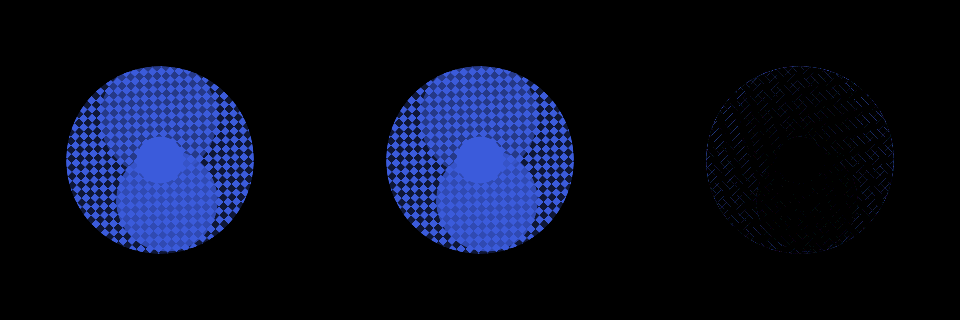
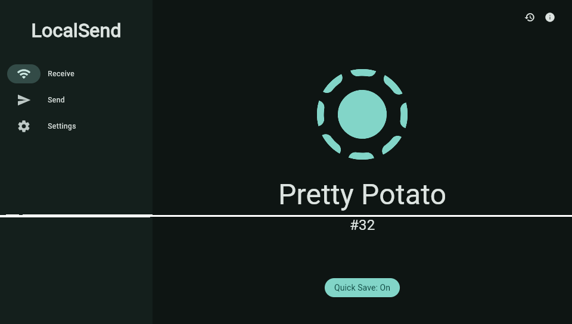

# ADR-0014: The raster pass is the bottleneck, so the GPU becomes the target

**Status:** Accepted — direction settled by measurement; the gating experiment
passed all four exit criteria on hardware on 2026-08-22. The GPU stays the
target; the vitaGL this ADR chose to reach it was replaced by `gles2/` on
2026-09-14 ([ADR-0019](0019-gles2-over-gxm-written-here.md))
**Date:** 2026-08-21

## Context

[ADR-0003](0003-software-rendering-first.md) shipped software rasterisation and
parked GLES2 as "a Phase 5 optimisation, measured against the software baseline
per workload rather than adopted wholesale". Its revisit trigger asked for
exactly this document:

> If the M3 baseline measurement shows the software path cannot reach the
> "laggy but working" bar on a counter app, GLES2 stops being an optimisation
> and becomes a Phase 3 blocker. **That reordering should be an explicit new
> ADR.**

Until 2026-08-21 the trigger could not be evaluated, because nothing separated
raster cost from everything else in a frame. The engine now times the raster
pass — `AcquireFrame` to the end of the encode callback — independently of the
present. That closes the question.

## The measurement

```
localsend, Receive screen:
FRAMES active 60 @ 205034 us = 4.87 fps (raster 199559 us = 97%, blit 1278 us = 0%, dmg 13%)
```

An active frame is raster + present + everything else, where "everything else"
is the UI thread: Dart building and laying out. The split is **97% / 0.6% /
~3%**.

| App / screen | dmg | raster | blit |
|---|---|---|---|
| manga_reader, idle | 0% | 704 us | 2 us |
| manga_reader, library | **5%** | **13,933 us** | 553 us |
| manga_reader, scrolling | **89%** | **13,965 us** | 9,713 us |
| localsend, Receive | 13% | **199,559 us** | 1,278 us |

Read the middle two rows together: **5% damage and 89% damage cost the same
raster.** Eighteen times the area, identical cost. The blit tracks area
faithfully — 553 us against 9,713 us — because a memcpy is honest about how
many bytes it moves. Raster is not, because **area is not work**.

What is inside localsend's 13% is one widget:

```dart
Transform.rotate(               // 30 fps tick
  child: ColorFiltered(         // forces a saveLayer
    colorFilter: ColorFilter.mode(primary, BlendMode.srcATop),
    child: Assets.img.logo512.image(width: 200, height: 200),  // 512 -> 200
  ),
)
```

Removing only the `ColorFiltered` and rebuilding took raster from ~199,000 us
to ~110,000 us. So the colour filter is roughly half, and the rotated downscale
is the other half. **Both are single-pass operations on any GPU**, and both are
worst-case for a CPU rasteriser: an offscreen allocation, a filter over every
pixel of it, and bilinear resampling through a matrix that changes every frame
so nothing caches.

## The two cheaper alternatives are now measured, and both fail

ADR-0003 named both. Neither survives the numbers.

**A NEON blit — ADR-0003's "cheapest large win in the embedder" — is now worth
nothing.** That recommendation was made when the blit was 8.06 ms of a
full-screen frame. [ADR-0007](0007-enable-partial-repaint-in-software-path.md)
then made the blit proportional to damage, and it is now **0.6%** of
localsend's frame and 2% of manga_reader's quiet one. Optimising it perfectly
buys under 1%. This is a good outcome recorded plainly: one ADR obsoleted
another's headline recommendation, and only measurement noticed.

**Reduced-resolution rendering is insufficient on its own.** 720×408 is 1.78×
fewer destination pixels. Even assuming raster scaled linearly with them — and
the 5%-equals-89% result says it does not scale with *area* at all — localsend
goes from 200 ms to ~112 ms, which is 8.9 fps. Reaching 30 fps needs raster
under ~30 ms, a 6.7× reduction. Resolution offers 1.78×. It remains genuinely
useful for manga_reader, where ~14 ms would become ~8 ms and 60 fps comes into
reach, so this is a **per-workload** tool, not a solution.

Neither is a path to a general fix, and that is the point: both scale the
existing cost down by a constant, while the problem is that certain *operations*
cost hundreds of times what they should.

## Feasibility, checked rather than assumed

ADR-0003's own GN comment still says the opposite of what is true:

> Software rasterisation only, per ADR-0003. The Vita's GPU is reachable
> **solely through libgxm — there is no GL, GLES, Vulkan or Metal driver on the
> device** […]
> — `flutter/tools/gn`, the `target_os == 'vita'` branch

That premise is stale. Checked on this machine:

| Question | Answer |
|---|---|
| Is there a GLES driver? | **Yes.** `libvitaGL.a`, `vitaGL.h` and a `GLES2/` include tree are already installed in VitaSDK |
| Does it conflict with [ADR-0004](0004-static-single-binary.md)? | **No.** vitaGL ships as a **static archive**. No `dlopen`, no shared object |
| Is Ganesh even compiled? | **Yes, already.** The vita GN branch sets `skia_enable_ganesh = True` with every backend off, because the engine assumes `GrDirectContext` as a *type* far more widely than it assumes a GPU |
| Do Ganesh GPU objects link for this target? | **Yes.** `gpu.LatticeOp.o` is in the shipped static archive today |
| Then what was the `dangerous relocation` link failure? | **Incidental.** `ninja -t query` names its consumers as `geometry_benchmarks` and **`libtessellator.so`** — a benchmark and a *shared library*. BFD aborted inside `elf32_arm_add_dynreloc`, emitting **dynamic** relocations for a link mode ADR-0004 means this port never performs. Neither target is ever built here |
| Is partial repaint lost on GL? | **No.** `FlutterOpenGLRendererConfig` carries `present_with_info` and `populate_existing_damage` precisely for dirty-region management |

That last row corrects a fear worth naming, because the software surface's own
comment invites it: *"the GL and Metal embedders cannot make that promise, since
they present by swapping buffers"*. That is about
`BackingStoreRetainsPreviousFrame` — handing back one surface forever — not
about damage support. The GL path tracks existing damage **per back buffer**
instead, which is more work in the embedder but is the supported, upstream way.

## Criterion 1: passed on hardware, 2026-08-21

`experiments/g1-vitagl` runs on the console and reports:

```
GL_VENDOR                   Rinnegatamante
GL_RENDERER                 SGX543MP4+
GL_VERSION                  OpenGL ES 2.0 VitaGL
GL_SHADING_LANGUAGE_VERSION 1.00 ES

compile fragment shader            PASS
compile vertex shader              PASS
link program                       PASS
FBO with texture attachment        PASS  status 0x8CD5
draw into FBO and read back        PASS  centre pixel rgba 0,255,0,255
```

The readback is the load-bearing line: green is what the fragment shader
writes, so it proves runtime GLSL compilation, program linkage, render-to-
texture and a real draw, rather than merely the absence of reported errors.
Render-to-texture passing matters most, because every `saveLayer` is one — and
`saveLayer` is what costs half of localsend's 199 ms frame.

### Limits, for criterion 3

| Limit | Value | Note |
|---|---|---|
| `GL_MAX_TEXTURE_SIZE` | 4096 | Comfortable |
| `GL_MAX_RENDERBUFFER_SIZE` | 4096 | Comfortable |
| `GL_MAX_VERTEX_ATTRIBS` | 16 | Comfortable |
| `GL_MAX_TEXTURE_IMAGE_UNITS` | 16 | Comfortable |
| `GL_MAX_VERTEX_UNIFORM_VECTORS` | 128 | Comfortable |
| `GL_MAX_VARYING_VECTORS` | 8 | The GLES2 floor; Ganesh targets it |
| `GL_MAX_FRAGMENT_UNIFORM_VECTORS` | **16** | **64 floats. Worth watching** |

Free pools after a context: VRAM 76 MiB, RAM 124 MiB, phycont 26 MiB.

Sixteen fragment uniform vectors is the one number that is not obviously
enough. It is the GLES2 minimum, and Skia's generated fragment shaders for
gradients, complex clips and colour filters can exceed it — which would surface
in criterion 3 as a link failure on a *specific* paint rather than as anything
systemic. Flagged here so it is not read as a surprise later.

## Criterion 0, added 2026-08-21: what a shader costs at run time

This was not in the exit criteria and should have been. The criteria gate on
whether the API works and say nothing about what using it costs, and shader
compilation is the one cost that could make a working GPU backend *worse* than
software for a UI toolkit -- a slow steady state is usable, a freeze every time
a new widget first paints is not.

Measured on hardware. `glCompileShader` is 10 us, because vitaGL only records
the source; all of the cost is `glLinkProgram`, where libshacccg runs:

| Shader | Cold | Cached, fresh process |
|---|---|---|
| trivial (89 chars) | 205,450 us | **2,916 us** |
| medium (150 chars) | 318,446 us | **3,290 us** |
| heavy (229 chars) | 404,640 us | **3,132 us** |

It is real compilation -- the cold time tracks complexity across an order of
magnitude of arithmetic -- with a floor of ~200 ms that even a one-line shader
pays. A frame at 30 fps is 33,333 us, so an uncached shader costs six frames at
minimum, and Ganesh generates one per paint configuration.

**The cache is what makes this survivable, and it is off in the VitaSDK
package.** That build has `HAVE_SHADER_CACHE=0`: `vglSetShaderCachePath` is a
two-byte `bx lr` and the archive imports only `sceIoMkdir`, no `sceIoOpen` or
`sceIoWrite`, so it cannot write a `.gxp` whatever path it is handed. The
documented setter silently does nothing. This was diagnosed by symbol size --
`vglSetTextureCacheFrequency` and `vglSetupScratchMemory` are also two bytes,
and the header documents both as requiring a `HAVE_*` flag, while every real
`vglSet*` is 0xc to 0x26 bytes.

Rebuilt from source with `make HAVE_SHADER_CACHE=1`, the same shaders load in
about 3 ms **regardless of complexity**, and the cache survives a process
restart. So the cost is once per shader per device, not once per launch.

### Consequences for the GPU direction

- **vitaGL must be built from source.** The packaged archive cannot be used as
  shipped. That is a new build dependency, and a small one next to what it buys.
- **First run still pays.** N distinct shaders cost N x ~250 ms the first time
  each is seen. For a hundred shaders that is ~25 seconds spread over first use.
- **A pre-warmed cache looks shippable.** The cache is plain `.gxp` files keyed
  by a hash of the source, and every Vita has the same SGX543MP4+, so a cache
  built on one console should be valid on all of them. Shipping one inside the
  `.vpk` would remove the first-run cost entirely. Unverified, and the obvious
  next question.

## Criterion 2: passed on hardware, 2026-08-21, and the cause was not the GPU

```
GrDirectContext created            PASS
backend                     0 (kOpenGL)
maxTextureSize              4096
maxRenderTargetSize         4096
GPU render target surface          PASS
draw and submit                    PASS
```

Three things had to be supplied before `GrDirectContexts::MakeGL` returned a
context, and none of them is the interesting one:

- **Six shims** for entry points vitaGL declares in `GLES2/gl2.h` and does not
  implement. `GrGLInterface::validate()` rejects an interface with any of the
  92 unconditionally required functions missing, and reports which branch fired
  to nobody in a release build. Two of the six are not honest implementations:
  `glBlendColor` discards its argument because vitaGL has no constant blend
  colour, and `glGetRenderbufferParameteriv` returns zeroes.
- **A suffix-stripping receiver.** Skia's assembler asks for extension entry
  points by their suffixed names — `GET_PROC_SUFFIX(PopGroupMarker, EXT)`
  requests `glPopGroupMarkerEXT` — and vitaGL exports the core spelling with no
  alias. A function that is present fails to resolve on its name alone, which is
  why an offline symbol-table diff said the debug-marker block was satisfied and
  the console disagreed.
- **`GL_NUM_PROGRAM_BINARY_FORMATS` forced to zero.** vitaGL answers 1 and
  advertises `GL_OES_get_program_binary` without providing its entry points,
  which is the same trick that broke `validate()` one layer up.

**What actually blocked it was libstdc++.** Bisecting down from `MakeGL` with
per-call-site traces ended at `SkMessageBus::Get()`, which is

```cpp
static auto* bus = new SkMessageBus<...>();
```

— a function-local static with a dynamic initialiser, and no GL or Skia in it.
A probe added to the experiment shows a plain `new` succeeding and the identical
allocation behind a function-local static killing the process: **libstdc++'s
`__cxa_guard_acquire` faults in this statically linked VitaSDK build.**
Supplying the ARM EABI pair by hand — the guard is a 32-bit word whose low bit
means initialised — makes the probe pass and carries Ganesh all the way to a
drawn frame, because a definition in the program overrides the archive's and
Skia's own statics then use it too.

This is a much larger fact than the GPU work. Every dynamically initialised
function-local static anywhere in the engine goes through those guards, and it
is a candidate explanation for the intermittent hard fault that has been open
since the test apps work. The experiment's version is correct for single-threaded
initialisation and nothing more; the engine needs a real one, and it is the
first item of the engine work below.

## Criteria 3 and 4: passed on hardware, 2026-08-22

`experiments/g2-ganesh` now draws the three operations from the measurement above,
on a 960×544 Ganesh render target and on an `SkSurfaces::Raster` of the same
size and colour type, and compares both the pixels and the clock. A baseline
draw — the same image, unscaled, unfiltered, no offscreen — runs alongside so
the three can be read as differences rather than absolutes.

### Criterion 3: the GPU agrees with the software rasteriser

There is no oracle on this console, so "correct" is defined as agreement with
the path the port ships today. A 320×320 window centred on the widget is read
back from both surfaces and compared per channel.

| operation | px gpu | px sw | colours gpu | colours sw | mean err | max | >8 | >24 |
|---|---|---|---|---|---|---|---|---|
| baseline image draw | 21,890 | 21,890 | 71 | 71 | 0.00 | 0 | 0.00% | 0.00% |
| saveLayer | 21,890 | 21,890 | 71 | 71 | 0.00 | 0 | 0.00% | 0.00% |
| colour filter | 21,898 | 21,898 | 47 | 47 | 0.00 | 1 | 0.00% | 0.00% |
| rotated 512→200 | 27,830 | 27,836 | 242 | 238 | 0.03 | 7 | 0.00% | 0.00% |
| localsend composite | 27,842 | 27,852 | 55 | 54 | 0.08 | 11 | 0.01% | 0.00% |

The first three are bit-exact. The two that resample disagree on a handful of
edge pixels by at most 11 of 255, which is two bilinear implementations
rounding differently and nothing more.



*Left: Ganesh on vitaGL. Centre: the software rasteriser. Right: the absolute
difference, multiplied by 16 to make it visible at all.*

**The first version of this check passed on nothing.** The source image had an
opaque white background, and `kSrcATop` is `src * dstAlpha + dst * (1 -
srcAlpha)` — an opaque tint over an opaque image is just the tint. The composite rendered
a flat 200×200 square in **two colours total**, and two identical flat squares
agree perfectly. Every number in the table was zero and every row said PASS.

It was caught by dumping the pixels and looking at the histogram, which is the
only reason this section is not a fabrication. Two things changed as a result:
the source image now has a real alpha silhouette, matching localsend's logo,
which is a PNG with transparency; and the comparison counts **distinct
colours** and fails below sixteen. Non-blank does not mean drawn, and a check
that cannot tell a solid fill from a photograph cannot answer this question.

### Criterion 4: 36× on the composite, and one operation that got slower

Twenty iterations each, microseconds per operation. `gpu` submits and waits
(`GrSyncCpu::kYes` → `glFinish` → `sceGxmFinish`) once per iteration; `gpu
batch` submits once for all twenty, which is the pipelining headroom.

| operation | software | gpu | gpu batch | ×  | × batched | first draw |
|---|---|---|---|---|---|---|
| baseline image draw | 1,155 | 1,626 | 259 | **0.7** | 4.5 | 2,663 |
| saveLayer | 2,419 | 4,035 | 3,920 | **0.6** | 0.6 | 4,182 |
| colour filter | 36,628 | 1,851 | 486 | **19.8** | 75.4 | 2,970 |
| rotated 512→200 | 107,519 | 1,992 | 551 | **54.0** | 195.0 | 2,800 |
| localsend composite | 172,054 | 4,761 | 3,946 | **36.1** | 43.6 | 4,618 |

**Criterion 4 passes: 36.1× against a bar of 10×.** The verdict is taken on the
per-submit column, not the batched one, because a frame ends in a submit
whether or not the operations inside it pipeline.

The software composite at 172 ms independently reproduces the 199 ms measured
in localsend's real frame, from a different image and a synthetic scene. The
model is faithful.

### What the isolated rows say, which is not what was expected

**`saveLayer` is slower on the GPU. So is a plain image draw.** Both come in at
0.6-0.7×, and batching rescues the image draw but not the offscreen: twenty
`saveLayer`s in one submit still cost 3,920 us each. That is not submit
overhead, it is the operation.

The Vita's SGX543 is a **tile-based deferred renderer**. Every render-target
switch resolves the tile buffer to memory and reloads it, so an offscreen costs
a full framebuffer round trip that an immediate-mode GPU does not pay. The
consequences section below predicted this would be where the experiment got hard and
named readbacks; it is the same mechanism, one step earlier.

So the win is not "the GPU is faster". It is narrower and worth stating
precisely:

- **Per-pixel work moves to hardware and collapses.** The colour filter is
  19.8× and the rotated downscale is 54×. These are the operations that made
  the software rasteriser's cost depend on *what* is drawn rather than how
  much, which is the finding this whole ADR rests on.
- **Structural work does not.** Offscreens get *more* expensive, and cheap
  draws gain nothing.
- **The composite still wins by 36×** because software pays 170 ms for the
  filter and the resample, against which one 4 ms tile round trip is noise.

There is also a floor: the baseline costs 1,626 us per submit-and-wait against
259 us batched, so a submit costs about **1.4 ms**. That is 4% of a 33 ms frame
and 8% of a 16 ms one — acceptable, and a reason not to submit more than once
per frame.

`first draw` is 2.6-4.6 ms across the board, which is the ~3 ms warm-cache
figure from criterion 0 and not the ~250 ms cold compile. The shader cache was
already populated from earlier runs, so this measures the good case only.

### What this means for localsend

The widget drops from ~172 ms to ~4.8 ms. Holding everything else in that frame
on the CPU — which is pessimistic, since it would move too — localsend's
199 ms raster pass becomes roughly **32 ms, about 31 fps**, from 4.87. That
clears [ADR-0006](0006-performance-bar-set-from-measurement.md)'s bar with the
conservative assumption still in place.

### The risk this creates for the embedder work

A Flutter tree is full of offscreens. `Opacity`, `ClipRRect` with antialiasing,
`ShaderMask`, `BackdropFilter` and every `ColorFiltered` lower to a `saveLayer`,
and the row above says each one costs ~4 ms on this GPU against ~2.4 ms on the
CPU. A screen with ten layers and no expensive per-pixel work would be *slower*
on the GPU than it is today.

That is not an argument against the direction — the operations that actually
hurt are 20× to 54× better, and they are the ones the test apps found. It is an
argument that the embedder needs the software path kept and selectable, which
[ADR-0003](0003-software-rendering-first.md) already requires for a different
reason, and that layer count becomes a thing to measure. It is added to the
revisit triggers below.

One shim question is answered: `glBlendColor` is stubbed to a no-op because
vitaGL has no constant blend colour, and the colour filter renders bit-exact
anyway, so Skia did not select a constant-colour blend coefficient for these
paints. That is evidence for these five operations and not a general result.

## Flutter on the GPU, 2026-08-22: the raster pass is fixed and the frame is not

The embedder now has both paths. `shell_enable_gl = true`, a
`FlutterOpenGLRendererConfig` in `vita_embedder.cc`, the six shims and the
suffix-stripping receiver moved out of the experiment into a proc resolver, and
vitaGL owning GXM and the display in place of this file's own CDRAM
framebuffer. Which path runs is decided at startup: GL unless
`ux0:data/flutter-vita/software.on` holds a `1`, and software automatically if
vitaGL cannot bring a context up.

Three things had to be fixed before any of it linked, and only the first is
about the Vita:

- **A thread-safe `__cxa_guard_acquire`.** The experiment's was three lines and
  correct only for single-threaded initialisation. The engine has a platform
  thread, a UI thread, a raster thread, an IO thread and Dart's workers, any of
  which can be first to touch a given static. `vita_cxa_guard.cc` is the real
  one: a global mutex and condition variable, a release barrier before the ABI's
  done-bit because the compiler tests that bit inline without a lock, and a
  recursive-initialisation check that traps with a message rather than waiting
  forever on a signal the waiting thread owes itself.
- **`embedder_external_texture_gl.cc`** includes Impeller's GLES backend
  unconditionally while `BUILD.gn` gates the dependency on
  `impeller_supports_rendering`, so it asks for `GLES3/gl3.h` with no include
  path to find it on.
- **`embedder.cc`** chooses `EmbedderSurfaceGLImpeller` on a *runtime* branch,
  referencing a class its own `BUILD.gn` did not build.

The second and third are the same upstream assumption: **`shell_enable_gl`
implies Impeller.** It holds everywhere else and cannot hold here, because
Impeller has no software backend and this port needs both. Recorded as
[patch 0009](https://github.com/flutter-vita/flutter/commits/vita-3.44.8).

### It renders

The gallery app draws correctly through Ganesh on vitaGL — text, Material
widgets, icons, an indeterminate spinner, a slider, antialiased rounded rects —
at 60 fps, which is the vsync ceiling rather than a measurement.

### localsend: 30× on raster, and no change to the frame rate

The test apps app that motivated this whole ADR, measured on hardware, same build,
switched between paths at run time:

| | software | GL |
|---|---|---|
| frame period | 168,268 us | 199,582 us |
| fps | **5.94** | **5.01** |
| raster | 156,103 us (92%) | **5,129 us (2%)** |
| raster max | 215,423 us | 9,713 us |
| present | 1,304 us | 196 us |

**Raster fell by 30×, from 156 ms to 5.1 ms, and the frame got no faster.** The
experiment's 36× was not wrong — the raster column is the experiment's prediction landing
almost exactly — but it was the answer to a question that turned out not to be
the binding one at the app level.

Two smaller findings sit inside that:

- **The first GL run of an app is not the one to measure.** It reported
  `raster max 1,006,493 us` — a one-second frame — and 5.40 fps. That is
  libshacccg compiling Ganesh's programs on first paint, at the ~250 ms each
  criterion 0 measured. The second launch, with the cache warm, is the table
  above. Anything quoting a cold run is quoting shader compilation.
- **`vglSwapBuffers` returns in 196 us**, so the frame rate is not vsync and
  not the present.

### Where the other 143 ms goes: the raster thread is starved

Two instruments settle it, and they agree.

```
FRAMES active 60 @ 159249 us = 6.27 fps (raster 28380 us = 17%, blit 356 us)
                             | raster max 1002816 us | gl wait 144108 us
LOOP   300 iterations @ 16627 us mean | 0 tasks
```

`gl wait` is the raster thread's idle time — present finished to the next
`make_current`. It is **144,108 us of a 159,249 us frame**: the thread that
draws is doing nothing for 90% of the period. `LOOP` eliminates the other
suspect, the platform thread, which is running at 16,627 us — the panel's exact
vblank — with no tasks pending in steady state.

So the frame rate is set upstream of both: **the UI thread.** Dart's build and
layout for localsend's Receive screen costs roughly 150 ms per frame, and it
always did.

### The correction this forces

**"raster is 97% of the frame" was measured correctly and read as if the frame
were serial.** It is not. Flutter runs UI and raster on separate threads and
pipelines them, so the period is `max(UI, raster)` rather than their sum, and
`raster / period` is a ratio of two overlapping things — not a share of a
budget. A raster pass at 97% of the period is exactly as consistent with "UI is
also ~100% of the period" as with "raster is the whole cost", and here it was
the former.

The arithmetic that seemed to rule this out earlier in this document — *a
168 ms period with 156 ms of raster leaves no room for a 150 ms UI thread* —
was the same mistake in miniature. With pipelining there is nothing to leave
room for:

| | UI | raster | period = max |
|---|---|---|---|
| software | ~150 ms | 156 ms | 168 ms observed |
| GL | ~150 ms | 28 ms | 159 ms observed |

Two paths whose raster differs by 30× land 6% apart, which is the proof on its
own.

**None of this makes the GPU decision wrong.** The experiment predicted the raster
pass would collapse and it collapsed, by 30×, on hardware, in a real app. What
changes is the claim that could be made afterwards: *localsend is not slow
because of the rasteriser.* It is slow because Dart takes 150 ms to build a
frame, and the software rasteriser happened to take almost exactly as long, so
neither was visible behind the other.



*The rotating dashed ring is the `Transform.rotate` + `ColorFiltered` widget
that cost 199 ms a frame on the CPU.*

### What the GPU is now worth, stated carefully

- **Headroom, not frame rate, on localsend.** 128 ms of raster thread came free
  and nothing is currently able to use it.
- **Frame rate wherever raster is the larger of the two.** manga_reader's
  library screen — 5% damage costing the same 13,933 us as 89% damage — is the
  clean case, and it has not been run under GL yet.
- **A different next question.** ADR-0006's bar is now a UI-thread question for
  at least one test apps, which is Dart AOT performance on a 444 MHz Cortex-A9
  and a completely different investigation from this one.

### Still unexplained

Every launch reports one frame of `raster max ~1,002,000 us` — a full second —
and it recurs with the shader cache warm, so it is not the first-paint
compilation that criterion 0 measured. Excluding it, raster is about 12 ms.
Worth chasing, and not chased yet.

### A hard crash under GL takes the console down, so GL is opt-in

Three console lockups on 2026-08-22, each needing the power button — the PS
button did not respond. All three were under GL, and they have one cause.

**Every exit path launched the receiver and called `sceKernelExitProcess` with
nothing in between.** That was correct for as long as this process never
touched the GPU: the software path owns a CDRAM block and a memcpy, and there
is nothing to hand back. Under GL it leaves a live GXM context and queued flips
naming memory the kernel is about to reclaim, and the shell composites through
the same driver — so the console goes, not just the app.

`experiments/g2-ganesh` hit this and fixed it with `sceGxmDisplayQueueFinish()` and
`sceGxmTerminate()` before the launch. The experiment had the easy version: one
thread, nothing else running. Here the exit is requested on the dev server's
thread while the *raster* thread is inside vitaGL, so the same two calls from
the caller would be the identical use-after-free one level up. The raster
thread has to be stopped first, and the only handle the embedder has on it is
`make_current` — refuse, and the engine stops handing it frames.

`flutter_vita_gpu_shutdown` does that, and every exit calls it: the dev
server's `handoff`, `relaunch` and `exit`, and `bailout.c`'s abort path. Weakly
referenced, so the software-only build is unchanged. Verified on hardware:

```
  [dev] handing off to the receiver
flutter-vita: releasing the GPU before exit
[ERROR:gpu_surface_gl_skia.cc(220)] Could not make the context current   (x18)
flutter-vita: GPU released
```

— eighteen frames refused while the raster thread quiesced, then a clean
handoff and the receiver back.

**The crash path cannot be fixed the same way, and this is the important
part.** `bailout.c` says it in its own first paragraph:

> Nothing can catch a hardware fault here. `excpmgr.h` exists only in [kernel]
> […] a data abort is not an exception.

A deliberate `crash` — a write to address zero — still wedges the console, and
no user code runs to prevent it. The supervisor cannot help: it is a separate
process and cannot release another process's GXM context.

So **GL costs a power cycle per hard crash**, on a port that still has them.
That was judged a bad trade for a default and a fine one for a deliberate
measurement, so the switch was first inverted from what the performance numbers
alone would suggest: `gl.on` selected the GPU, software otherwise.

#### The default flipped on 2026-08-24

[ADR-0017](https://github.com/flutter-vita/flutter-vita-bench/blob/master/docs/adr/0017-the-gallery-becomes-the-benchmark.md) replaced the impression
that GL is faster with twelve measured scenes, and the margin turned out to be
larger than the crash cost:

```
ux0:data/flutter-vita/software.on   -- a '1' forces the CPU path
```

GPU otherwise. Worst-frame, software over GL, warm cache: 20.33× on a backdrop
blur, 18.38× / 17.00× / 16.89× on the three route transitions, 7.25× on a
saveLayer tint, 3.25× on image scaling. **No scene is below 1.00×.** The first
reading of this table had GL losing two of them; both losses turned out to be
measurement — a cold shader cache and a software frame rate too low to sample —
and are written up in ADR-0017.

Nothing above about the crash cost has been repaired. It is now a risk taken
deliberately in exchange for those numbers, and the escape hatch is one `put`
away rather than a rebuild. Two callers still want the CPU path and get it: the
receiver forces it through a strong `flutter_vita_force_software` symbol
([ADR-0016](0016-the-receiver-becomes-a-flutter-app.md) decision 7), and anything
needing text input wanted it until the common dialog could composite over
vitaGL. The second caller went away on 2026-08-28: text input now runs on
libime's inline keyboard, which does not use the common dialog at all. See
[the IME finding below](#the-system-ime-is-unusable-under-gl-and-fine-without-it).

#### The first thing the new default did was wedge the console

Same day, during a benchmark run. `vitaGL`'s `_glTexSubImage2D` clones a
texture before modifying one the GPU used recently, and the clone's allocation
is unchecked:

```c
void *texture_data = gpu_alloc_mapped_for_gpu(size);
vgl_fast_memcpy(texture_data, tex->data, size);   /* NULL when the pools are dry */
```

The dump named the size: `0x3FFFC0`, 4 MB — a 2048×2048 A8 glyph atlas, which
is what Skia pushes through `glTexSubImage2D` as text comes and goes. Every
pool had been tried (VRAM, RAM, PHYCONT, BUDGET) and the collector had run its
`FRAME_PURGE_FREQ` cycles. So this is genuine GPU-memory exhaustion, and the
crash is what the code does about it.

`patches/vitagl/0001`
skips the clone instead, and three sibling paths with the same shape with it.
The cost is writing into a buffer the GPU may still be reading: a tear on one
frame of one texture, against a power cycle. A dropped upload is otherwise
invisible — and invisible is how a benchmark ends up measuring a picture of a
frame rather than a frame — so the patch also counts them, and the embedder
prints the count with its periodic loop statistics.

This does not make GL safe; it removes one way of reaching the unsafe state.

#### And then the exhaustion explained itself

`TEXTURES_SPEEDHACK=1` — a vitaGL build flag, upstream-documented as making
`glTexSubImage2D` "non fully OpenGL compliant but … slightly faster" — took the
dropped-upload count from three to **zero** on the same run.

What it compiles out is the clone: without it, `_glTexSubImage2D` copies any
texture the GPU touched in the last four frames before modifying it, and the
old copy waits for the collector. Skia's glyph atlas is that 4 MB texture and
Skia sub-uploads into it whenever text changes, so every text change cost 4 MB
allocated and 4 MB pending. The compliance traded away is a tear on one frame of
one texture — the same trade the patch above makes when an allocation fails,
made unconditionally.

Reaching the NULL had a second cost, too. The unsafe allocator asks the
collector to run and then `sceKernelDelayThread(1000000)` — one flat second —
and retries itself up to four times. So one contended allocation froze the
raster thread for four seconds, and the log showed an 8 s frame where two
landed back to back. The collector already signals a semaphore at the end of
every cycle; waiting on that with a 50 ms ceiling took the worst frame gap
across a full benchmark run from **8145 ms to 66 ms**.

Both are in
`patches/vitagl/0001`
and its README.

**Still open**, unchanged: a way to release the GPU from outside the faulting
process.

### manga_reader: the case where raster *is* the constraint, and it wins

localsend was the wrong app to judge this on. manga_reader is the right one —
it is where ADR-0014's own evidence came from, the 5%-damage-costs-as-much-as-
89% pair — and here raster and the blit are the larger share rather than a
co-bottleneck with Dart.

Same app, same screen (Library, loading), switched at run time, debug overlay
off on the software side:

| | software | GL |
|---|---|---|
| fps | 45.2–46.6 | **59.0–61.3** |
| frame period | ~21,900 us | ~16,700 us |
| raster | 11,956 us | **2,034 us** |
| blit / swap | 9,286 us | ~650 us |
| **work per frame** | **21,242 us** | **2,684 us** |
| raster thread idle | — | 10,356 us |

**7.9× less work per frame, and the frame rate goes 45 → 60.** The 60 is the
panel, not the ceiling: `gl wait` says the raster thread is idle for 10.4 ms of
every 16.7 ms frame, so there is substantial headroom vsync is hiding.

Two things this fixes that the software path could not:

- **The blit disappears.** 9,286 us of memcpy per frame becomes a swap, because
  the GPU renders into the display target and there is nothing to copy.
  [ADR-0007](0007-enable-partial-repaint-in-software-path.md) made that copy
  proportional to damage; at 89% damage, proportional is nearly all of it.
- **Raster stops tracking area.** 11,956 us to 2,034 us on the same content.

So the honest summary across both apps is that the GPU does exactly what the
experiment said, and whether that shows up as frame rate depends on which stage was
slowest to begin with — which is the ordinary answer for a pipelined renderer
and should have been the expectation going in.

### The shader cache works; the one-second frame is something else

Checked on device: `ux0:data/shader_cache/v0/v` holds 14 programs and `.../f`
holds 20. vitaGL creates the directory tree itself in `vglInitExtended`, so the
manual `sceIoMkdir` loop this embedder inherited from the g1 experiment is
redundant — and it was creating the wrong names anyway. Two caches exist and
they are not the same shape:

- **Fixed-function**, `ffp.c`: `ux0:data/shader_cache/v<FFP_MAGIC>/{v,f}/...`
- **Custom shaders** — what Skia uses — `custom_shaders.c`:
  `<root>/v<SHADER_CACHE_MAGIC>/{v,f}/<hash>.gxp`, where `root` defaults to
  `ux0:data/shader_cache/<TITLEID>` unless `vglSetShaderCachePath` overrides it.

This embedder overrides it to the bare `ux0:data/shader_cache`, which works but
puts our programs in the tree other homebrew shares. The per-title default is
tidier and is what a shipped app should use.

With the cache demonstrably populated, **the ~1,130,000 us frame in the first
window of every launch is not compilation.** 34 cached programs at the ~3 ms
each criterion 0 measured is ~100 ms, not 1.1 s. The likely candidate is the
first frame's texture uploads: `make_resource_current` is null, so every upload
is synchronous on the raster thread. Unverified.

### Screen transitions: 95% of the lag is Dart, on either path

Reported from the console: transitions still stutter under GL exactly as they
did on the CPU. They do, and the measurement says why. Sixty-frame means cannot
see this — a single 500 ms frame inside a window of 16 ms frames moves the mean
by 8 ms and vanishes — so the embedder now logs any frame whose period exceeds
50 ms on its own line, with the split between raster and raster-thread idle.

Driven reproducibly through localsend's left nav with the dev server's `tap`,
same three destinations on both paths:

| | software | GL, first visit | GL, repeat visit |
|---|---|---|---|
| transition frame | 472–506 ms | 341–471 ms | 296–493 ms |
| of which raster | 38–67 ms | 110–366 ms | **5–21 ms** |
| remainder — the UI thread | ~430 ms | ~230–405 ms | **272–483 ms** |

**The renderer is 5–21 ms of a ~400 ms transition.** Building and laying out a
new route is the whole cost, it is Dart, and no renderer change reaches it. GL
feeling identical to the CPU here is the correct outcome rather than a defect.

The second and third columns are the other half of the answer: on a screen's
**first** paint under GL, raster experiments to 110–366 ms, and repeating the exact
same navigation in the same process drops it to 5–21 ms. That is the one-time
cost of a new paint configuration — criterion 0's "a freeze every time a new
widget first paints", landing exactly where it was predicted. It does not
recur in-process. It will recur per launch for any screen the shader cache has
not seen, which is what makes shipping a pre-warmed cache worth doing rather
than merely tidy.

### The console has been running at 333 MHz the whole time

Found while looking for what could move a UI-thread bound number: **nothing in
this port ever set the clocks.** The Vita starts an application at 333 MHz with
the bus and GPU below their maximums, and 444 MHz is the rated speed that
essentially every homebrew title selects — not an overclock.

So every measurement in this repository, back to Phase 0.5, was taken on a
downclocked console, and the stage that dominates is precisely the one a CPU
clock affects. `scePowerSetArmClockFrequency(444)` plus the bus, GPU and xbar
equivalents now run before the engine starts.

Measured, localsend's Receive screen under GL, same build, same screen:

| | 333 MHz | 444 MHz |
|---|---|---|
| fps | 5.00 | **5.83** |
| frame period | 199,582 us | **171,285 us** |
| UI thread (`gl wait`) | ~190,000 us | **158,301 us** |

**+17% frame rate, free.** The clock ratio predicts −25% on a compute-bound
stage and the UI thread gave back −17%, so it is mostly compute and partly
waiting on something else — memory, most likely, which the bus clock only
partly addresses.

Transitions move by roughly the same proportion and remain dominated by the UI
thread: 85 / 327 / 338 ms at 444 against 296 / 493 / 384 at 333, with raster
between 2 and 11 ms throughout. Noisy, because the app's own state differs run
to run, but the direction is consistent and the split does not change.

It costs battery and heat, which is the trade every other Vita application
already makes.

### Draining platform tasks faster does not help

Tried and reverted, recorded so it is not retried.

The platform thread answers the engine once per vblank, which bounds the
*latency* of a platform reply at 16.6 ms however fast the reply itself is. The
log shows the framework issuing `LiveText.isLiveTextInputAvailable`,
`Clipboard.hasStrings` and `ProcessText.queryTextActions` on every navigation,
and a chain of replies that each gate the next would pay a frame apiece — ten
sequential round trips is 166 ms, which is a real fraction of a 400 ms
transition.

Draining fifteen times a frame at 1 ms granularity instead produced no
improvement and made the noisier samples worse. The mechanism is
straightforward in hindsight: waking the platform thread fifteen times a frame
and taking the task mutex each time competes for a core with the UI thread, and
the UI thread is exactly what the transition is waiting on. The change spends
the thing it was trying to save.

### Known gaps in the GL path

- **No partial repaint.** `populate_existing_damage` is null, so every frame is
  a full repaint. ADR-0007 is a software-path property today.
- ~~**No IME.**~~ **Closed 2026-08-28.** The gap was real for the common
  dialog and the fix was to stop needing it: libime's inline keyboard
  composites after `sceDisplaySetFrameBuf` and never touches GXM, so it works
  on both backends unchanged. See the IME finding below.
- **No debug HUD.** It paints into a CPU framebuffer that no longer exists.
- **No resource context.** `make_resource_current` is null, so texture uploads
  are synchronous on the raster thread and the engine says so once at startup.
  Providing one needs a second GL context, and vitaGL has one.
- Screenshots still work, because `sceDisplayGetFrameBuf` asks the hardware
  what it is scanning out and does not care who allocated it.

## Three findings that cost the experiment four runs

**1. The shader compiler works, and the taiHEN chain under it is real but not
a blocker.** Removing one layer at a time from the link line gives:

```
libvitaGL.a        -> shark_*, sceShaccCg*   (gxm.o, ffp.o, custom_shaders.o)
libvitashark.a     -> sceShaccCgExt*
libSceShaccCgExt.a -> taiHookFunctionOffsetForUser, taiInjectDataForUser, ...
```

`gxm.o` is vitaGL's own init, so `vglInit` calls `shark_init` before any Skia
code exists, and `ffp.o` means vitaGL compiles even its built-in fixed-function
shaders at run time. The chain is not optional in the packaged build.

It is also not a problem: `shark_init(NULL)` returns **0** on this console. The
module is present at `ur0:data/libshacccg.suprx` and the hooks resolve.

The taiHEN edge is the `*ForUser` family. Every `ForKernel` entry point in
`taihen.h` takes an explicit `SceUID pid`; the `ForUser` ones take none — they
patch `SceShaccCg` **inside our own address space** and die with the process.
That is not what [ADR-0011](0011-crash-recovery-without-taihen.md) declined:
its stated reasons are *a module inside SceShell can hang the shell* and *two
`config.txt` experiments left the console unbootable*, and an in-process hook
reaches neither. It is recorded here rather than treated as settled, because
ADR-0011's rule is written flat.

**2. A safe self fails in ways that look like hardware limits.**
`vita_create_self` builds a *safe* self by default, and a safe self cannot read
`ur0:` or resolve taiHEN's user hooks — regardless of the HENkaku "unsafe
homebrew" setting. The experiment was built safe while the receiver and the app
template have always been `UNSAFE`. The symptom was `vglInit` returning
`GL_FALSE` on a console with 182 MB free and the module correctly installed,
which reads as a platform limitation and is a missing keyword.

**3. `vglInit` returns `GL_FALSE` on a context that works.** Every check above
passes immediately after it. Removing the experiment's own `shark_init` call did not
change the return value, so it is not induced by the probe. Three runs treated
the boolean as authoritative and exited without calling a single GL entry
point; what contradicted them was the console itself, showing vitaGL's splash
screen — `invoke_splashscreen`, on its own thread — rotating at a smooth 60 fps
while the report on disk claimed there was no context.

**Do not trust `vglInit`'s return value. Probe the context.**

A related trap, from the same run: vitaGL defers shark translation to link
time, so `glCompileShader` validates almost nothing. A vertex shader missing
its `attribute vec2 aPos;` declaration reported `PASS` from both compiles and
then hung the console inside `glLinkProgram`.

## Decision

**The GPU is now the primary performance target, and Skia Ganesh over vitaGL is
the route.** GLES2 is reordered from "Phase 5 optimisation" to the next major
engine work item, which is the reordering ADR-0003 asked to be made explicit.

**Engine work is gated on an experiment**, because the feasibility table above
establishes that nothing *forbids* this and says nothing about whether vitaGL
serves what Ganesh asks for. The experiment is not the port; it is the smallest
program that answers that. Exit criteria, all on real hardware:

1. ~~A vitaGL GLES2 context initialises, and `libshacccg.suprx` compiles a
   trivial shader at runtime.~~ **PASSED 2026-08-21** — see above. The module
   is user-installed and the community already relies on it; the dependency it
   drags in is stated in full above.
2. ~~Skia builds with `skia_use_gl = true` and `skia_gl_standard = "gles"` for
   `target_os = vita`, and a `GrDirectContext` is successfully created on a
   vitaGL context.~~ **PASSED 2026-08-21.** The blocker was neither Skia nor
   vitaGL: libstdc++'s `__cxa_guard_acquire` faults in this statically linked
   build, so every function-local static with a dynamic initialiser is a hard
   fault.
3. ~~Skia draws the three operations that dominate the measurement above —
   `saveLayer`, a colour filter, and a rotated downscale of a 512×512 image —
   and the output is correct.~~ **PASSED 2026-08-22** — bit-exact on three of
   the five, and at most 11 of 255 on the two that resample.
4. ~~The same three are timed against the software path. **The bar is 10×**, not
   "faster": below that, the binary-size and complexity cost is not obviously
   worth it and the per-workload tools above deserve another look.~~
   **PASSED 2026-08-22 at 36.1×** on the composite widget — with one operation,
   `saveLayer`, coming out *slower* on the GPU.

**The experiment has passed, and the engine work is unblocked**: a
`FlutterOpenGLRendererConfig` path in `vita_embedder.cc`,
`populate_existing_damage` against GXM's buffering, the GN branch above
rewritten with its stale premise removed, and — first, because nothing else
runs without it — a thread-safe `__cxa_guard_acquire` for the engine build. The
experiment's is correct for single-threaded initialisation only, and the engine has
a UI thread, a raster thread, an IO thread and Dart's workers.

## Consequences

- **[ADR-0003](0003-software-rendering-first.md) is not superseded.** Its
  decision — ship software first — was correct and is why there is a working
  port to measure. What changes is the ordering it deferred, exactly through
  the mechanism it specified.
- **The software path stays.** It is the fallback when `libshacccg.suprx` is
  absent, and `shell_enable_software` remains true regardless. Two paths is
  more embedder surface, and that cost is accepted.
- **`libshacccg.suprx` becomes a runtime dependency for the fast path.** An app
  must still start and render without it.
- Binary size grows by Skia's GL backend. Memory is not the binding constraint
  — 188 MiB largest contiguous, and the engine is ~14.5 MiB resident — so this
  is a download-size concern, not a device one.
- The Vita's GPU is a **tile-based deferred renderer**. Skia's GL backend
  assumes immediate-mode in places, and readbacks are disproportionately
  expensive on TBDR. Expect this to be where the experiment actually gets hard.
- [ADR-0002](0002-skia-not-impeller.md) is untouched: this is Ganesh, Skia's
  GPU backend, not Impeller. Impeller has a GLES backend and is where upstream
  is investing, which is a real argument to revisit — but not one to take on
  the same day as reordering the renderer.

## The bound on this conclusion, stated honestly

localsend's headline number is dominated by **one pathological widget**. A GPU
fixes it; so would deleting one `ColorFiltered`. Anyone reading "97%" as "Flutter
is slow on Vita" has read too much into it.

The claim this ADR actually rests on is narrower and better supported:
**the software rasteriser's cost is driven by what is drawn, not how much**, and
the operations that hurt it — saveLayer, filters, resampling under a changing
transform — are the ones hardware performs for free. manga_reader's
5%-costs-as-much-as-89% pair is the cleaner evidence, because nothing
pathological is involved in it.

## The system IME is unusable under GL, and fine without it

Found on 2026-08-22 by a gallery build that froze on a tap into a text field:
the process stayed alive, its dev server answered, the platform loop held a
clean 16,627 us and touches kept arriving -- and not one frame reached the
panel again.

The same tap on the same app rebuilt for software opens `SceImeDialog` over
the app and everything keeps running: `present #1980`, loop unchanged, the
dialog rendering normally.

The difference is who owns the display. On the software path this embedder
allocates the CDRAM framebuffer and calls `sceDisplaySetFrameBuf` itself, so
the common dialog has somewhere to composite. Under GL, vitaGL owns GXM and
the display, and the dialog has nothing it can draw into -- it takes the
screen and the app never gets it back.

So text input and the GPU were exclusive for six days -- a second cost on the
GL path beyond the crash behaviour above, landing on exactly the apps most
likely to want the GPU.

### Resolved 2026-08-28, by not using the common dialog

The conclusion above is correct about `sceImeDialog` and wrong about text
input, because it assumed the modal dialog was the only system keyboard. It is
not. `SceIme` (`psp2/libime.h`) is a second, older interface: an **inline**
keyboard the shell composites into the lower part of the panel *after*
`sceDisplaySetFrameBuf`, leaving the application's frame alone. It never asks
for a GXM surface, so the question of who owns the display does not arise --
it works identically on both backends, and the embedder needed no `g_gl_enabled`
branch for it.

Three things this costs, none of them fatal:

- **It composites outside the captured framebuffer.** `sceDisplayGetFrameBuf`
  returns what the app drew, so `shot` never contains the keyboard. Verifying
  it on hardware means reading the event log, not looking at a capture.
- **This console rejects `SCE_IME_OPTION_MULTILINE`** outright
  (`0x80100715 = SCE_IME_ERROR_INVALID_OPTION`). `OpenIme` degrades option by
  option until `sceImeOpen` succeeds and records what it actually got, so a
  multiline field opens as single-line and `PRESS_ENTER` stays wired to
  `performAction` rather than inserting a newline.
- **`vglSwapBuffers` needs its `has_commondialog` argument set** while the
  keyboard is up, which keeps vitaGL's common-dialog path alive. That is why
  `vglInitExtended` is used -- its CDIALOG budget computes to 0 and
  `vgl_has_cdlg_support` stays TRUE.

`sceImeDialog` itself is now unreferenced. Its **GXM surface setup is not**,
and the claim in the commit that introduced libime -- that both were dead on
both paths -- was wrong. libime reaches the screen through
`sceCommonDialogUpdate`, which takes the mapped framebuffer, the depth surface
and the sync object; under GL vitaGL makes that call inside `vglSwapBuffers`,
and on the software path this embedder makes it itself. Delete the surfaces and
the software path loses its keyboard.

One piece of dialog-era behaviour does survive and is now wrong: on the
software path the main loop holds the last frame while the keyboard is up, so
the app freezes underneath. That was correct for a modal that owned the whole
screen and is not correct for a panel covering the bottom third. It stays for
now because the fix is not local -- `sceCommonDialogUpdate` must run on the
thread that owns the GXM context, which is the main loop, while the frame copy
runs on the raster thread. Under GL the app keeps animating, because vitaGL
composites inside the swap on the correct thread already.

The frozen build also produced a smaller lesson worth keeping. It reported
`match=vitaGL` while `gl.on` contained `0`, which looked like the opt-in
switch failing. It was not: the `.vpk` was built 56 minutes before the engine
artifact was repackaged, so it linked the engine from *before* GL became
opt-in and ran the GPU unconditionally. **Any binary built against an older
artifact ignores the switch**, and `shotinfo` is the cheapest way to find out
which path an installed app actually took.

## Revisit trigger

- **The experiment fails criterion 4.** If vitaGL plus Ganesh is under 10× on those
  three operations, this ADR is wrong and the answer is per-workload work:
  reduced resolution for fill-bound screens, and a `psvita` lint or widget set
  that steers apps away from the operations that hurt.
- **Crash recovery under GL.** A hard crash currently costs a power cycle
  because a data abort runs no user code and nothing releases the GXM context.
  Until that changes, GL stays opt-in whatever the frame rate says.
- **Layer-heavy screens turn out slower on the GPU.** Criterion 4 measured
  `saveLayer` at 0.6×, and a Flutter tree is full of them. If a real app's frame
  regresses once the embedder GL path exists, the answer is not to abandon the
  GPU but to choose the backend per app or per screen — which makes the
  two-path embedder a permanent feature rather than a transition.
- **`libshacccg.suprx` becomes unavailable or unacceptable.** Then Ganesh has
  no runtime shader compiler and the route is a precompiled shader cache, which
  is a materially different project.
- **Upstream removes the Ganesh GL backend.** Skia is investing in Graphite and
  Flutter in Impeller. [flutter-upgrade-cost.md](../flutter-upgrade-cost.md)
  shows Impeller took 336 files and +13,110 lines in one release window while
  the Skia software path took 5 insertions. If GL goes, the question reopens as
  Impeller-GLES versus staying on CPU.

## Related

- [ADR-0002](0002-skia-not-impeller.md) — Skia, not Impeller; unchanged here
- [ADR-0003](0003-software-rendering-first.md) — the decision this reorders, through its own trigger
- [ADR-0004](0004-static-single-binary.md) — why vitaGL being a static archive matters
- [ADR-0006](0006-performance-bar-set-from-measurement.md) — the bar this is measured against
- [ADR-0007](0007-enable-partial-repaint-in-software-path.md) — made the blit small, and thereby obsoleted the NEON-blit recommendation
- [test apps-localsend-2026-08-19.md](../results/test apps-localsend-2026-08-19.md) — the raster attribution in full
