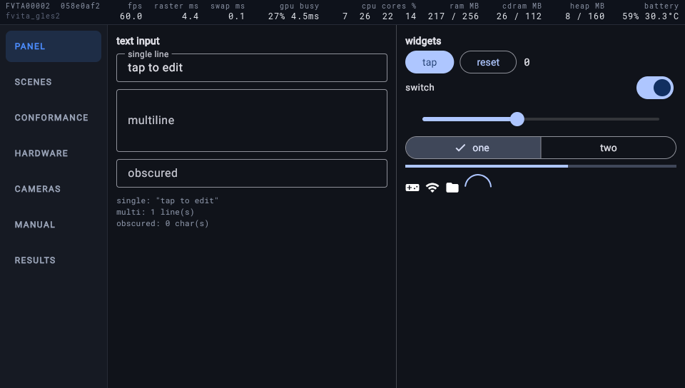

# Debug an app

There is no debugger cable, no DevTools and no observatory on this port
([why](the-profiler-we-do-not-have.md)). What there is: a strip of live
numbers over every debug build, the app's log over the network, screenshots
and taps from the host, and crash dumps with symbols. This page goes
through them in the order you reach for them.

## The debug strip

Every app built without `--release` can draw this over the top 34 pixels
of the screen. It is hidden at the start:



Press **L + R + SELECT** to show it and again to hide it; `flutter-vita`
does the same from the host with `overlay off` and `overlay on` on the
app's port. Nothing in the app is involved: the engine composes the strip
and copies it onto each finished frame after the GPU is done with it, so
it costs the app no widget, no rebuild and no GPU time. Its own cost is
about 80 µs a frame, reported as `hud` on the log's `FRAMES` line.

| Column | What it is | What to read from it |
|---|---|---|
| **fps** | Frames presented per second over the last twenty frames, counting only frames that came within 250 ms of the previous one. An idle screen reads `0.0`. | The number you are tuning. 60 is the display's rate. |
| **raster ms** | Skia's time on the raster thread per frame: recording the layer tree into GL calls and flushing them. | Grows with blur, saved layers, large images, many shaders. If this is near 16 the GPU path is your limit. |
| **swap ms** | The wait to queue the frame for display. | Grows when the GPU has fallen behind: frames queue up. Near zero otherwise. |
| **gpu busy** | GPU load over the window, and its time per frame. Past 100% when frames queue behind each other. | The GPU's own cost, separate from Skia's. |
| **cpu cores %** | Load on each of the four cores. | A core at 100 is the UI thread or the raster thread with no room left. Frame time minus raster minus swap is the UI thread: if fps is low and raster is small, look at your `build`. |
| **ram MB** | Main memory used, over the process's budget. | The budget is 256 MB and it is shared with the heap below. |
| **cdram MB** | GPU memory used, over its budget of 112 MB. | The number the GL path runs out of first: textures and render targets live here. A screen that allocates textures every frame shows it climbing. |
| **heap MB** | The C heap used, over the arena the app reserved at start (160 MB by default). | The heap has ended more long runs than the budget has. Dart's own heap is separate and inside `ram`. |
| **battery** | Charge, and the battery's temperature, the one temperature user mode can read. | How long a benchmark has. |

The left of the strip names the title id, the engine commit and the
renderer (`fvita_gles2`; `software` on the CPU path). On the software path
the third and fourth columns are `blit ms` and `damage`: the copy to the
display and the share of the screen repainted.

Under the numbers: the strip is a fixed layout, so a column is always
where it was. The values are averaged over twenty frames and update three
times a second at 60 fps; on an idle screen they refresh once a second.

Until 2026-10-28 an app without `flutter_vita` showed the strip from the
first frame. Now every app starts with it hidden. To show it from the first
frame, call `FlutterVita.configure(debugStrip: DebugStrip.always)`. A build
that must never draw
the strip defines `int flutter_vita_debug_overlay = 0;` in any C file
compiled into the app; `--release` does that for you.

## The log

```sh
flutter-vita logs
```

Everything the engine, the framework and your `print` calls wrote, from
launch. The lines worth knowing:

- `flutter-vita: FRAMES active 60 @ 16664 us = 60.00 fps (raster 5122 us =
  30%, ...)`: one line every sixty frames with the same numbers as the
  strip, plus the layer's counters. This is what to quote in an issue.
- `flutter-vita: JANK frame #1234 gap 83 ms (raster 4 ms, wait 79 ms)`: a
  frame that took over 50 ms. `raster` is Skia's part; `wait` is the raster
  thread waiting for the UI thread, which means Dart was building.
- `flutter-vita: channel vita/... [n] ...`: a platform channel message the
  embedder saw.
- `unimplemented: glSomething`: the GLES2 layer met a call it does not
  have yet. Also collected in `ux0:data/flutter-vita/gles2-unimplemented.txt`.

Logs of past runs stay on the card under `ux0:data/flutter-vita/logs/`,
and the bridge's LOGS tab lists them by title.

## Screenshots and taps

```sh
flutter-vita screenshot out.png
flutter-vita tap 480 272
```

The screenshot is what the display controller scans, so it shows what a
person would see, strip included. Hide the strip first if you want a clean
one. `tap` presses the panel at those coordinates; the gallery's tabs, for
instance, sit down the left at x=60.

## Crashes

An app that faults leaves a dump, `psp2core-*.psp2dmp`, under `ux0:data`.
The console then comes back to the bridge by itself (a debug build
links a fallback that launches it on `abort` and on a fault), and the
bridge's CRASHES tab lists the dump with the thread that faulted.

From the host:

```sh
./tools/analyse-crash.sh apps/my_app/build/vita/cmake/flutter_vita_app
```

pulls the newest dump and symbolicates it against the app's ELF: the
fault type, every thread's stack, the registers. The ELF has to be the one
that produced the dump; a rebuilt app symbolicates to confident nonsense.

An `abort()` (a failed Dart assertion, an `FML_CHECK`) writes its reason to
`ux0:data/flutter-vita/bailout.txt` before the fallback runs; the bridge
shows it too.

## When the console stops answering

A silent port is one of three things:

1. **The console went to sleep.** Press the power button. Turn automatic
   standby off in Power Save Settings while developing.
2. **The app is stuck.** Hold **L + R + START** for a second: the app hands
   the console to the bridge without needing the network. The bridge's
   LOGS tab has the app's last lines.
3. **The app died without a dump.** The bridge comes up on its own; look
   at CRASHES and at the last log.

Nothing here needs the power button held down. If the screen has frozen
and the chord does nothing, wait: a debug build has a watchdog on the UI
thread that writes a stall report to `ux0:data/flutter-vita/stall.txt`
(every thread's state, at twenty and twenty-five seconds of silence),
copies the log beside it, and relaunches the app at thirty. Pull both with
`get` on the app's port once it is back.
