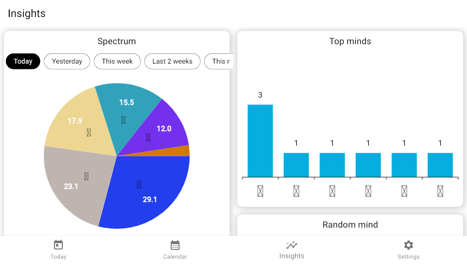
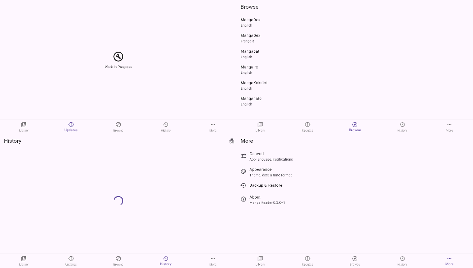
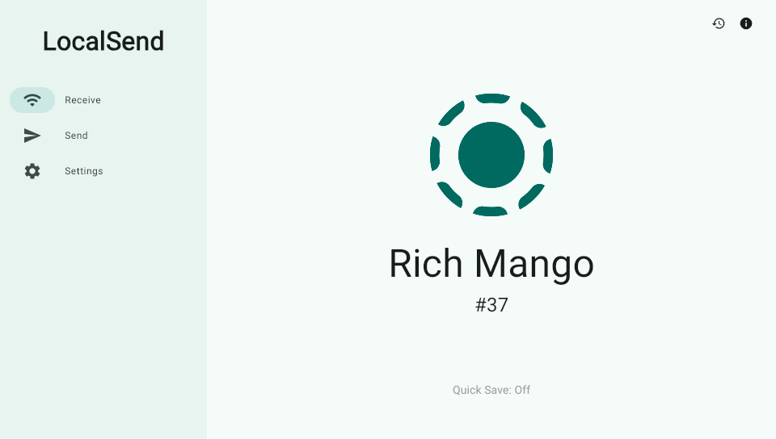

# The four remaining test apps on fvita_gles2

**Question:** `material_3_demo` already runs through the layer. Do the other
four apps of [`apps/test-apps/manifest.txt`](../../samples/test-apps/manifest.txt)
reach their screens on `--gl gles2`, and where they look different from the
August records ([test apps, run end to end](corpus-run-2026-08-19.md)), is
the layer the reason?

**Builds:** engine `2d7f2a4` plus the two embedder changes below, gles2 as of
`36d6a9c` plus the translator change below, all four apps rebuilt on
2026-09-13/14 with `build-vita-app.sh <app> --gl gles2`. Screenshots over
the dev server's `shot`, logs over `log`.

| app | first frame | screens driven | fps at rest | `unimplemented:` | `stall.txt` |
|---|---|---|---|---|---|
| keklist | yes | Today, Calendar, Insights, Settings | 57 to 60 | none | `-` |
| flutter_manga_reader | yes | Library, Updates, Browse, History, More | 60 | none | `-` |
| wonderous | yes | intro (3 pages), home, 4 wonders by swipe | idle screen | none | `-` |
| localsend | yes | Receive, Send, Settings; `/api/localsend/v2/info` answers over HTTPS | 29 to 33 (its own 30 Hz ticker) | none | `-` |





## What the run found

### 1. Skia emits user functions; the translator refused them

Wonderous draws its images with `FilterQuality.high`. Skia's bicubic image
shader carries its child `MatrixEffect` as a GLSL function:

```
mediump vec4 MatrixEffect_S1_c1_c0_c0_c0_h4h4f2(mediump vec4 _input, highp vec2 _coords) {
return texture2D(uTextureSampler_0_S1, (umatrix_S1_c1_c0_c0_c0 * vec3(_coords, 1.0)).xy, -0.475);
}
```

The gallery's 46-shader corpus has no such function, so the translator had
`only main`. Wonderous asked for this one shader 52 times in a minute
(Skia rebuilds a failed program on every draw that needs it), and every
element drawn with it stayed a black disc:


`gles2/src/translate.c` now parses `type name(params) { body }` before
`main`, emits it as a Cg function ahead of `main`, checks calls against
the parameter list, and refuses a function that reads an attribute, a
varying or a `gl_` name (those are `main`'s parameters in Cg; Skia passes
them as arguments anyway). The shader is `gles2/corpus/skia-46-frag.glsl`;
M2 on the console is 47 of 47, this one in 1391 ms.

### 2. The "cold bridge" was a 5 second name lookup

Every `nc flutter-vita.local` paid 5.00 s before the connect, measured with
`getaddrinfo`: macOS asks mDNS for an AAAA record first, the console's
responder has no IPv6 to answer with, and the resolver waits the full
timeout before it falls back to the A record. `nc -4` connects in 0.06 s.
That lookup was paid once per file by `deploy.sh`: wonderous' 454-file
bundle took 45 minutes, and after the change the same deploy takes 39 s.
Every `nc` in `tools/` now has `-4`. The retries in `alive()` stay; a
bridge that has just started is still a real case.

### 3. A screenshot was a smear of forty frames

The first localsend capture had rows of zeros across the sidebar, in
different places on every shot. `shot` sent the display buffer straight
from CDRAM over Wi-Fi, which takes over a second; the layer rotates three
display buffers, so the GPU was back in the captured one two flips later,
and the tail of the capture came from later frames, some rows not yet
written. `ReadFramebuffer` now waits for a vblank, copies the front buffer
into a block of its own (22 ms for 2 MB of CDRAM) and sends the copy.
`shotinfo` prints the copy time. The panel never showed this; it is a
capture defect, not a rendering one.

### 4. STALL reports on a screen with nothing to draw

Wonderous parks on a wonder until touched. The embedder's present-based
stall check reported every 5 s, ten times, a raster thread that was idle
because it had been given nothing. With the raster idle and the heartbeat
answered within 2 s, `CheckForStall` now stays quiet; `CheckUiThread`
owns the other case.

### 5. Differences from August that are not the layer's

- **manga_reader's Library** shows the app's "Something went wrong" widget
  where the 2026-08-22 screenshot had a spinner. The same vpk on vitaGL,
  same engine, same hour: spinner at 30 s, the same widget at 80 s. The
  manifest predicted it: the app's sqlite3 is FFI opened lazily. The other
  four tabs draw and navigate on both backends. The theme is light where
  August's was dark; that is a stored preference, not a render.
- **keklist's emoji are tofu.** The checkout on this machine has no
  `NotoColorEmoji` in its `pubspec.yaml`, so patch `keklist-0004` is not
  applied to it; the 2026-08-18 record shows the same tofu for the same
  reason.
- **localsend** logs `MissingPluginException` for `package_info`, as in
  August.

## What this says about parity

Five of five test apps reach their screens through `fvita_gles2`, with one
translator gap found and closed. The bicubic shader is the first Skia
shader outside the gallery's corpus that the layer met, and the corpus is
the gate: a new app's shader becomes a corpus file, then a translator
change, then an M2 line.
