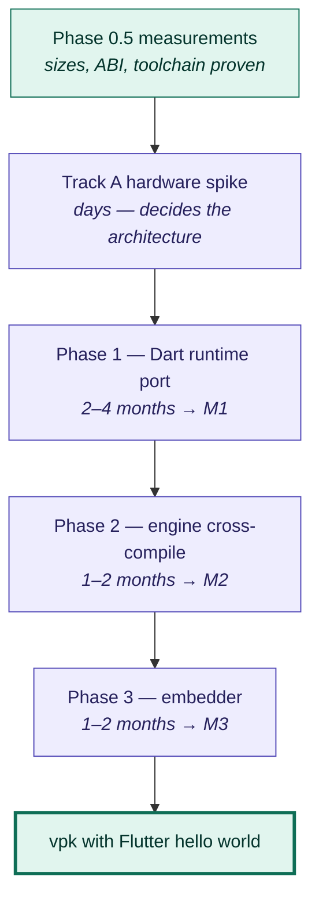

# Roadmap — from here to a `.vpk` with Flutter inside

The question this answers: *what stands between today and a `.vpk` containing a
working Flutter hello world?*

Short version: **the Flutter engine has never been compiled for Vita.** That is
the blocker, and it is most of the project. Everything else on the path is easy
by comparison.

**Roughly 5–8 months** at the plan's own estimates. The ordering is forced —
each stage consumes the previous stage's output.

---

## The chain, with what each stage actually needs

| # | Stage | Cost | Blocking? |
|---|---|---|---|
| 1 | VitaSDK installed | hours | trivial |
| 2 | `.vpk` packaging pipeline — `vita-mksfoex` → `vita-make-fself` → `vita-pack-vpk` | days | **not on the critical path** |
| 3 | **Dart runtime ported** — threads, TLS, mutexes, condvars, virtual memory, time | **2–4 months** | yes — everything downstream needs it |
| 4 | **Engine cross-compiled** — GN toolchain for `arm-vita-eabi`; zlib, libpng, HarfBuzz, ICU, Skia (raster only), libtxt, engine core, all through newlib | **1–2 months** | yes |
| 5 | **Embedder** — `FlutterEngineRun`, software present → GXM blit, vsync, task runners, touch | **1–2 months** | yes |

Stages 3 and 4 overlap in practice: the usual porting pattern is to get the
engine *linking* against a stubbed platform layer first (that is exactly what
milestone M2 is), then make each stub real.

## The tempting shortcut, and why it fails

ardera ships a working armv7 `libflutter_engine.so`. We already use it — B3a
measured it, B1 and B2 used its `gen_snapshot`. So: can it just go in a `.vpk`?

**No.** It is a Linux ELF, linked against glibc, issuing Linux syscalls, loaded
by a dynamic linker the Vita does not have. Nothing about it is reusable at
runtime.

Its value is entirely as a *reference*: a size baseline, a known-good build to
diff against, and a host-side `gen_snapshot` that saves us building the Dart SDK.
That is a lot of value — it just is not a shortcut through Phases 1–3.

## What is *not* blocking

**Packaging.** You can have a `.vpk` running on your Vita this week — it just
contains C, not Flutter. That is [Track A](phase-0.5-feasibility.md#sequencing),
and it is worth doing precisely because it moves packaging, deployment, and log
capture out of the unknown pile permanently. When the engine finally exists,
getting it into a `.vpk` should be a solved problem rather than a new one.

## M1 is the honest halfway point, and it ships on its own

**A `.vpk` with pure Dart AOT inside** — no Flutter, no Skia, no engine — needs
stage 3 but not 4 or 5. "Dart runs on PS Vita" is a publishable project in its
own right, and B1 has already done its host half: we can generate the armv7
snapshot today. What is missing is the Vita half.

The plan's own risk register rates single-maintainer burnout as High. If that is
real, **aim at M1, not M3.** It is the first artifact that is both reachable and
worth showing to someone.

## The two estimates to distrust

Both are rated High in the plan's risk register, and neither has prior art on
Vita:

- **Phase 1** — nobody has mapped Dart's threading, TLS, and virtual-memory
  assumptions onto `sceKernel*` and newlib. The one-line plan entry
  `os_thread_vita.cc — threads, mutex, condvar, TLS` is a heroic understatement.
- **Phase 2** — nobody has run a foreign toolchain through the Flutter engine's
  GN build. Whether it even works on a macOS host is unknown; that is one reason
  Docker exists in the plan.

Everything measured so far has come in *at or better than* estimate. That is not
evidence these two will.

## Related

- [Phase 0.5](phase-0.5-feasibility.md) — the current gate and all measurements
- [ADR-0005](adr/0005-aot-snapshot-delivery.md) — decides how the snapshot gets in
- [ADR-0007](adr/0007-enable-partial-repaint-in-software-path.md) — may become required in Phase 3
- [Vita3K as a target](vita3k-as-a-target.md) — why the spike must run on hardware
